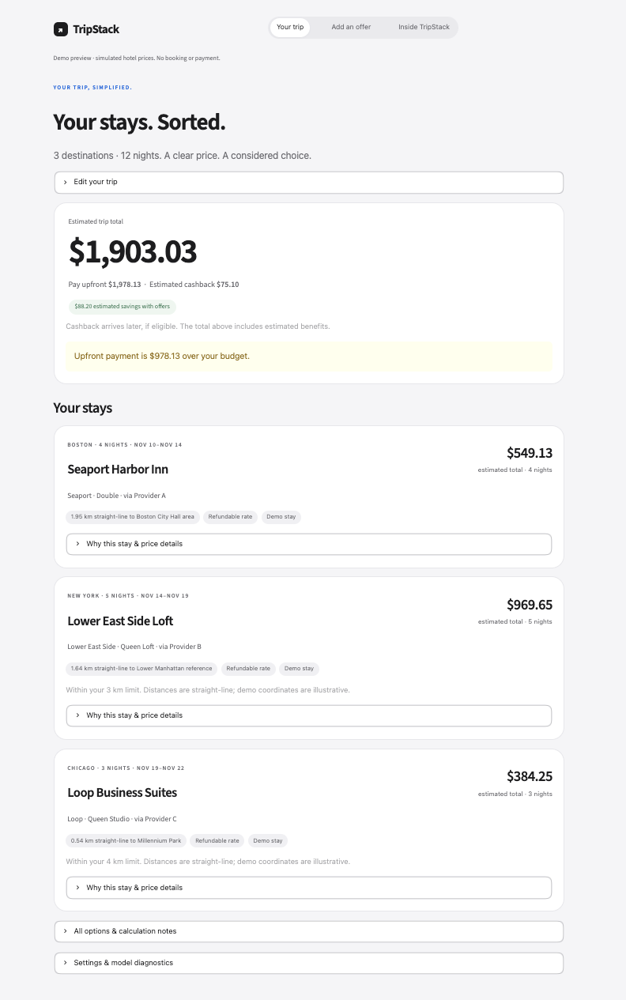
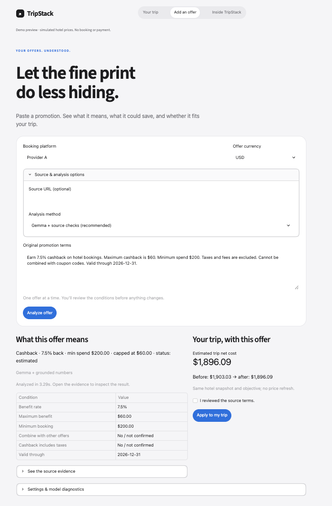
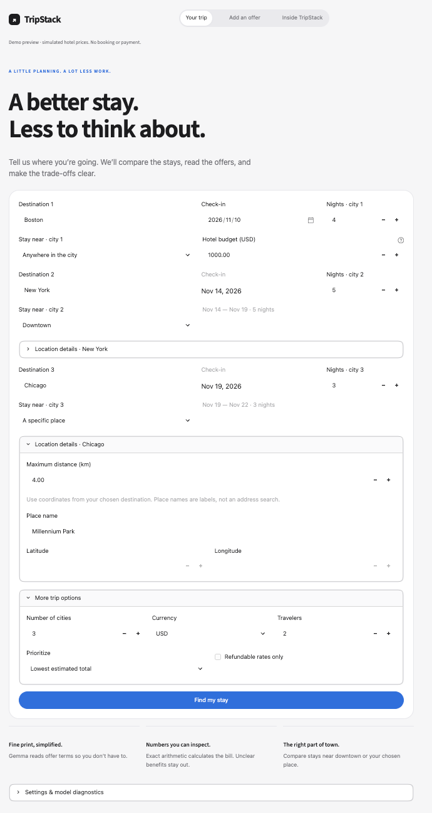
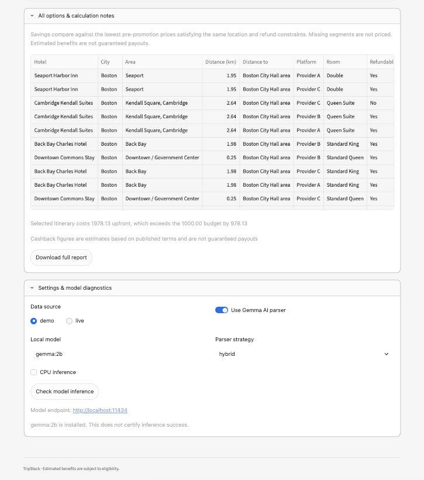

# TripStack

Hotel comparison with promotion-term parsing and location preferences.

TripStack compares upfront payment and estimated cost after cashback. Each
recommendation includes its price breakdown, promotion conditions and location
reference. The app does not book rooms or process payments.

## Product walkthrough

The screenshots below use simulated hotel quotes and coordinates. They show the
working comparison and offer-review flow, not live market prices or verified
savings. Amadeus integration code is included, but live account access and
production quote retrieval have not yet been validated.

### Compare the cost of a trip

Recommendations separate upfront payment, estimated cashback and estimated net
cost. Location preferences and refund filters constrain the available choices;
over-budget plans are explicitly flagged.



### Read promotion terms with Gemma

Paste terms, inspect the extracted conditions, and preview their impact on the
same hotel quote snapshot. Source evidence is available for review. Applying an
offer does not verify eligibility or guarantee a payout; model failures are
labelled and can fall back to the rule parser.



<details>
<summary>Trip setup and calculation settings</summary>

Plan multiple destinations with a downtown radius or a custom coordinate
reference. A place name is a label; it is not automatically geocoded.



Inspect alternative offers and model settings. A model being installed does not
establish that an inference check has succeeded.



</details>

## Run locally

Install Python 3.11 or later and Git, then clone the repository. Keep the
checkout directory named `tripstack`, as the code imports that package name.

```bash
git clone https://github.com/michelleeyin/tripstack.git tripstack
cd tripstack
```

Create an isolated environment and start the app:

```bash
python3 -m venv .venv
source .venv/bin/activate
python -m pip install -r requirements.txt
python -m streamlit run app.py --server.port 8599
```

Open <http://localhost:8599>. Enter a destination, dates, nights and budget,
then select **Find my stay**. Multi-city trips, currency and ranking preferences
are under **More trip options**.

Demo mode needs no API credentials. Hotel prices, hotel coordinates and curated
promotions in this mode are simulated fixtures, not live offers.

Configuration is read from environment variables. `.env.example` lists the
available settings; the application does not load `.env` automatically.

## Promotion parsing

Gemma runs through Ollama. On macOS, install and start it with:

```bash
brew install ollama
ollama serve
```

Keep that terminal running. In another terminal:

```bash
ollama pull gemma:2b
```

`gemma:2b` is the default model. Set `OLLAMA_MODEL` to use another installed
model. For the CPU startup option used on this project, see
[local model setup](docs/gemma-workflow.md).

In **Add an offer**, paste one promotion, review its conditions and source
excerpts, then apply it to the trip. The preview uses the existing hotel quote
snapshot. Removing an offer recalculates the plan without fetching new prices.
Reviewed offers remain estimates; reviewing extraction does not verify a payout.
Custom offers are stored in the current browser session.

| Method | Numeric fields | Other conditions |
|---|---|---|
| `hybrid` | Rule parser | Model, with explicit source conditions taking precedence |
| `ai` | Model, validated against source text | Model, with source checks |
| `rules` | Rule parser | Rule parser |

A model error triggers a labelled rule-parser fallback. Ambiguous terms,
conflicting amount roles and unresolved benefits are excluded from savings.
**Inside TripStack** shows extraction records; **Settings & model diagnostics**
provides an actual inference check. An installed model is not treated as proof
that inference works.

[Parser benchmark](docs/parser-benchmark.md) records a small, dated experiment.
Its results are not a general accuracy guarantee or a measurement of every
subsequent parser revision.

## Location preferences

Each destination supports unrestricted location, a radius around a named
downtown reference, or a custom reference with coordinates. Active radius
filters exclude offers outside the radius and offers without coordinates.
Distances are straight-line kilometers, not walking or transit estimates.

Built-in references currently cover Boston, Chicago and New York. A reference
point is not an official neighborhood boundary. Live coverage is limited to the
provider candidates returned by the search.

See [location behavior and examples](docs/location-preferences.md).

## Pricing

```text
Upfront payment    = room rate + taxes + mandatory fees - instant discounts
Estimated cashback = eligible spend × rate, subject to the offer cap
Estimated net cost = upfront payment - estimated cashback
```

- Amounts use decimal arithmetic rounded to cents; rates retain six decimals.
- Taxes and fees enter cashback calculations only when the rule allows it.
- Unknown benefits do not reduce reported costs.
- Promotion selection respects stacking and the selected ranking objective.
- Verified-benefit cost excludes estimated discounts and cashback.
- Quotes in another currency are excluded; there is no currency conversion.
- Savings baselines use pre-promotion prices under the same location and refund
  constraints. Partial itineraries are labelled; unmatched cities are not priced.

## Live hotel search

The Amadeus adapter requires credentials:

```bash
export AMADEUS_CLIENT_ID=...
export AMADEUS_CLIENT_SECRET=...
python -m streamlit run app.py --server.port 8599
```

Choose **live** in settings. Without credentials, the app displays a notice and
uses demo data. The default Amadeus host is its test environment, which is not a
source of production booking quotes. Configure `AMADEUS_HOST` for an authorized
production account. The live integration still requires validation with that
account's coverage and permissions.

## Tests

```bash
python -m pytest -q
```

The suite covers pricing, eligibility, parsing, model failures, location
constraints and page interactions. Automated model tests use mocked responses;
live smoke checks are documented separately.

## Code layout

| Path | Responsibility |
|---|---|
| `app.py`, `design.py` | Page flow and visual design |
| `promotion_workspace.py`, `workflow.py` | Offer review and quote-snapshot recalculation |
| `ai/` | Model client, prompts, extraction and source validation |
| `engine/` | Eligibility, pricing, ranking and location filtering |
| `models/` | Validated input and result structures |
| `providers/` | Demo fixtures and Amadeus adapter |
| `data/` | Demo records and benchmark cases |
| `tests/` | Automated tests |

## Limits

Cashback is an estimate. Regional, membership and payment-card eligibility are
not fully modeled. Curated demo rules are not a live promotion search. Refund
policies and rates must be confirmed before booking. There is no automatic
checkout, payment, account scraping or transport-cost calculation.

## Contributing and license

See [CONTRIBUTING.md](CONTRIBUTING.md) for changes and tests.
The project uses the [MIT license](LICENSE).
